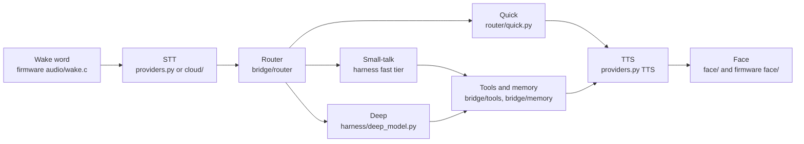

# Architecture

Skwoop is a desk companion: a round-display pod and a host service called the bridge. The bridge may run on any computer. The goal is to move the voice loop onto the pod. That move is staged. The pod firmware in this tree has never run on hardware.

The diagram is the intended turn. Several boxes are code that compiles, not behavior that has been seen on a device. The sections below say which.

## Wake word

`firmware/components/audio/wake.c` loads a WakeNet model from the model partition (`wake_start`). `CONFIG_SKWOOP_WAKE_KEYWORD` defaults to `heyskwoop` (`firmware/components/audio/Kconfig`). That model is not in the tree (`firmware/models/README.md`). If it is missing, the loader falls back to the esp-sr "Hi ESP" model, which `sdkconfig.defaults` selects (`CONFIG_SR_WN_WN9_HIESP`). MultiNet command phrases, when packed, come from `firmware/components/cmds`.

This has not run on hardware. Nothing here claims a wake word works.

The bridge does not detect a wake word. `bridge/webpod/server.py` is the stand-in: the browser sends listen start/stop (and an optional barge flag) over a websocket. `bridge/skwoop_bridge.py` accepts that xiaozhi session (`POST /xiaozhi/ota/`, `GET /xiaozhi/v1/`). Opus mic audio in, Opus speech out.

## STT

On the bridge, `bridge/providers.py` transcribes with the xAI speech API (`STT_PROVIDER`, default `xai`). Streaming, interim text, and end-of-speech settings are the `STT_*` variables in `.env.example`. The bridge also ends a push-to-talk turn on listen-stop, and runs a VAD (`VAD_*` in `bridge/skwoop_bridge.py`).

On the pod, `firmware/components/cloud` is an OpenAI-compatible transcription client (`POST {base}/audio/transcriptions`). `firmware/main/standalone.c` records until `firmware/components/audio/endpoint.c` says the utterance ended, then calls that client. Keys are names of slots in encrypted NVS, not values compiled into the image. This path is behind `CONFIG_SKWOOP_STANDALONE` and has not run on a device.

## Router

`bridge/router/__init__.py` `route()` picks a tier. Nothing is fired inside `route`; it only classifies.

| Tier in code | In the diagram | What answers |
| --- | --- | --- |
| `instant` | Quick | `bridge/router/quick.py` (weather right now, clock, date, timers) and the phrase table in `bridge/intents.json` (lights, TV, "play this title"). A clip or a script, no model. |
| `fast` | Small-talk | `bridge/harness/` with a small tool set: chit-chat, house state, one-step actions, calendar, lists, a quick search, texting. It can hand off. |
| `deep` | Deep | Notes, memory writes, research, multi-step asks, and music. `bridge/harness/skwoop_turn.py` and `bridge/harness/deep_model.py`. |

`SKWOOP_HARNESS` defaults off (`bridge/harness/__init__.py`). With it off, model turns go to the deep path. With it on, the fast tier runs first and escalates.

The on-pod subset is `firmware/components/skwoop/src/skwoop_harness.c`: instant / fast / deep labels, local memory recall, timers, and clock. The file says music, home control, and Matter are not in this step. The host build of that harness does not link the bridge client.

## Tools and memory

Bridge tools live in `bridge/tools/`:

- `house_tools.py`, `ha_service.py` — Home Assistant (lights, calendars, lists, weather, TV scripts)
- `reminders.py` — reminders through that same house client
- `quick_search.py` — one web search through an OpenAI-compatible HTTP endpoint
- `music.py` — Spotify Web API, with a model pick when the ask is vague
- `messaging.py` — a contact file plus an external send script, and only after a spoken yes
- `grokipedia.py` — a short factual lookup used by the harness

Memory is `bridge/memory/memory_recall.py` (read) and `bridge/memory/memory_write.py` (remember / forget last). Both talk HTTP to a memory service. The recall URL is `SKWOOP_MEMORY_RECALL_URL`. The service is optional: if it is down, the call fails and the turn says so. This is not an on-pod store.

The pod's own store is `firmware/components/skwoop/src/skwoop_memory.c`, used by the standalone harness. It is a small local fact list, not the bridge memory service.

`bridge/notes_pick.py` can search a notes directory (`SKWOOP_NOTES_WIKI`, `SKWOOP_NOTES_LOOSE`) before a deep turn. Default paths are under the home directory and are meant to be overridden.

## Deep model

There is one deep-model interface, and it is OpenAI-compatible HTTP. No vendor SDK is wired in.

- `bridge/harness/deep_model.py` streams `POST {DEEP_MODEL_BASE_URL}/chat/completions` with `Authorization: Bearer ${DEEP_MODEL_API_KEY}`. The body model is `DEEP_MODEL_NAME` (default `deep`). `DEEP_MODEL_PROVIDER` is sent only when a per-turn model override names one. The module is off unless both the base URL and the API key are set. A file (`SKWOOP_DEEP_STREAM_OFF_FILE`) turns the stream off without a restart. If the stream fails before the first sentence, the bridge uses the webhook path.
- `bridge/providers.py` class `LLM` uses the same three variables when `LLM_MODE=deep` (the default when `DEEP_MODEL_BASE_URL` is set). `LLM_FALLBACK_XAI=1` can call xAI directly with `XAI_API_KEY` if the deep line is down.
- `bridge/harness/pod_agent.py` `ModelClient` is the in-process protocol for the fast and deep tool loop (stream text, run a tool, stop). The HTTP client behind it is still an OpenAI-compatible chat completion, not a second integration.
- `bridge/harness/skwoop_turn.py` is the fallback: `POST` `SKWOOP_WEBHOOK_URL` signed with `SKWOOP_WEBHOOK_SECRET`.

Firmware chat, when standalone is on, is the same idea in C: `firmware/components/cloud` posts to an OpenAI-compatible chat URL from menuconfig, with the key read from NVS.

## TTS

`bridge/providers.py` class `TTS` is the pluggable speech path. `TTS_PROVIDER` selects `elevenlabs`, `xai`, or `say` (the last is a local `say` binary, used for benches). ElevenLabs is one provider. Its voice comes from the environment (see `.env.example`) and is empty unless you set it. No voice identifier is committed.

Order inside `synth()` when the clip library is enabled: a whole recorded sentence, then a piece-wise overlap join (`bridge/skwoop_lib.py`, `bridge/stitch.py`), then live TTS. `SKWOOP_LIBRARY=0` forces live TTS. The library itself is not shipped.

On the pod, `cloud_tts` in `firmware/components/cloud` is either OpenAI-compatible `/audio/speech` or ElevenLabs, chosen in menuconfig. The ElevenLabs voice default in Kconfig is the placeholder `your-voice-id`.

## Face

The drawing that GitHub Pages can host is `face/`: `face.js` (`FaceSim`, `drawRobot`), numbers in `face-data.json`, and an optional expression layer (`pad-face.js`, `expressions.json`).

The pod drawing is `firmware/components/face`. It has not been seen on a panel.

During a bridge turn, `bridge/skwoop_bridge.py` sends `llm` frames whose emotion comes from `bridge/tone.py` (keyword mode) or `bridge/skwoop_mood/` when `SKWOOP_TONE=pad`. The web pod and the firmware face map those names onto a mood. The mood weights file is optional, CC-BY-SA, and not in this repo. `firmware/tools/export_mood.py` builds `firmware/components/mood/mood_v11.bin` from a separate mood-model checkout. Missing file: mood stays off.

## What runs where

| | Pod firmware today | Bridge host today | Where it is going |
| --- | --- | --- | --- |
| Wake word | Code in `firmware/components/audio/wake.c`. Preferred model not shipped. Never run on a device. | Not detected. The web pod sends listen start/stop. | On the pod, once a model is packed and the image has actually booted. |
| Microphone, VAD, Opus | `voice.c`, `endpoint.c`, `opus_io.c`. Compiled, not run on hardware. | Web pod captures PCM in the browser and sends Opus. The bridge decodes with `bridge/opus.py` (libopus). | On the pod. |
| STT | `firmware/components/cloud` (standalone only). Untested on hardware. | `bridge/providers.py` (xAI). | Pod calls a speech API. Not an offline claim. |
| Router, quick answers | Subset in `skwoop_harness.c` (clock, timers, local memory). | `bridge/router`. | On the pod for the subset; the full phrase table stays on the bridge until a later stage. |
| Tools, house, music, texting | Not in the on-pod harness. | `bridge/tools/`. | Stay on the bridge host until each one has an on-pod design. |
| Memory service | Small local store only (`skwoop_memory.c`). | `bridge/memory/` over HTTP. | Local facts on the pod; the long-term service stays a host plugin. |
| Deep model | OpenAI-compatible client in `firmware/components/cloud`, keys in NVS. Untested on hardware. | `bridge/harness/deep_model.py`. | Same HTTP interface, called from the pod. |
| TTS | `cloud_tts`, untested on hardware. | `bridge/providers.py`. | On the pod, still a network provider. |
| Face | `firmware/components/face`, untested on hardware. | Browser: `face/` and `bridge/webpod/static/`. | The panel on the pod. |

`sdkconfig.defaults` sets `CONFIG_SKWOOP_STANDALONE=y`, so the developed image includes the on-device loop (`firmware/main/standalone.c`). The Kconfig default for that symbol is off: without the defaults file, the firmware keeps the bridge websocket client (`firmware/components/bridge`, `firmware/main/main.c`). Either way, nothing in `firmware/` has been flashed.

Staged plan, matching that split:

1. **Now.** Bridge on a computer, browser web pod instead of hardware. Face demo is static files.
2. **Pod as a client.** Flash the image with standalone off. The pod talks to the bridge over the xiaozhi websocket. The bridge still does STT, routing, tools, and TTS.
3. **Pod loop, cloud speech and model.** Standalone on: wake, record, cloud STT, the small harness, cloud chat, cloud TTS, face. House tools and the memory service stay on the bridge host.
4. **Later.** Move more of the router and the local tools onto the pod. Still no promise of offline speech or an on-device LLM.

No step above has a measured latency, a battery figure, or a claim that the wake word hears you.
