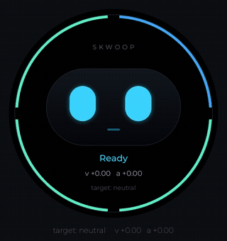
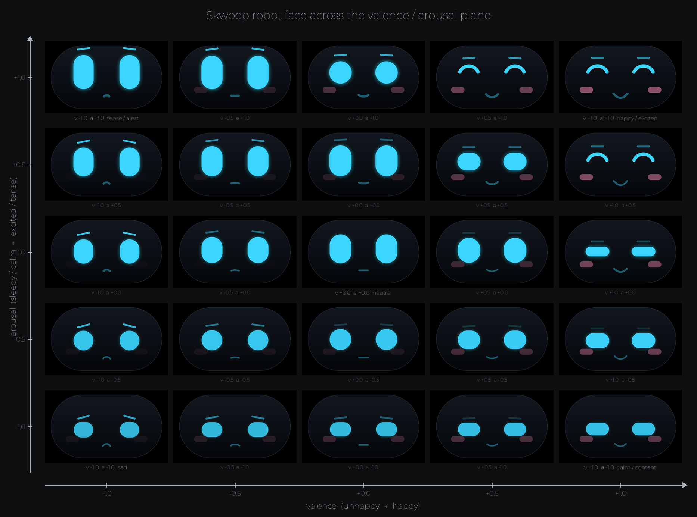
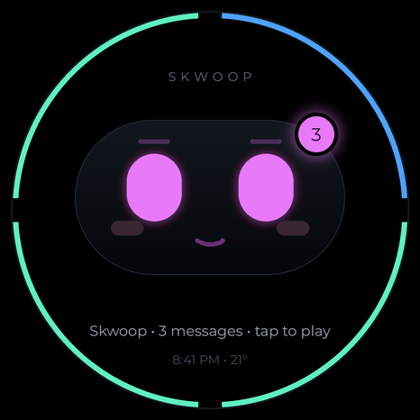

# Skwoop web face



Skwoop is a desk companion. This directory is its open-source web face.
Pod firmware lives in `../firmware` and has not run on hardware.

The canvas is 466×466, matching the 1.75-inch round display.

## Run

From this directory:

```sh
python3 -m http.server
```

Open <http://localhost:8000/>. Buttons switch idle, listening, thinking,
and speaking. Add `?face=dot` for the sample drawing, or `?pad=1` to cycle
named expressions.

Opening `index.html` from disk also draws: `face-data.js` is the same object
as `face-data.json`. If those numbers are missing, the page says: Serve with
python3 -m http.server.

If the system asks for reduced motion, the demo stops the bob and the blinks.

## Architecture

A mood point (valence and arousal) moves through a critically damped spring.
`FaceSim` turns that into a snapshot: pose, blink, glance, and bob.
`drawRobot` paints the snapshot. With `?pad=1`, `pad-face.js` supplies the
pose from `expressions.json` instead of the valence/arousal blend.

The `k*` keys in `face-data.json` are the firmware face constants. They keep
the Hungarian `kFoo` names and the same values the pod firmware uses,
including the 466 screen and the eye gap. `SkwoopFace.init` loads that object
once; the drawers read it. Do not rename those keys on the web side only.

## Assets



The robot face across valence (unhappy to happy) and arousal (calm to excited).



A message on the round face: wordmark, count badge, and a status line. The
live page draws its wordmark as canvas text. It asks for Montserrat and falls
back to the browser sans-serif. Montserrat is under the SIL Open Font
License; this directory does not ship the font file. These previews are
covered by the repository MIT license.

`assets/robot-face-glide.mp4` is the motion clip the GIF was made from.
GitHub does not play a relative `.mp4`, so the GIF at the top is the one
to embed.

## Files

- `face.js` — mood spring, face sim, and robot drawing (`SkwoopFace`)
- `face-data.json` — the constants, pretty-printed
- `face-data.js` — the same object, inlined for `file://`
- `pad-face.js`, `expressions.json` — expression layer (`?pad=1`)
- `sample-face/dot-face.js` — a drawing-only sample (`?face=dot`)
- `index.html`, `demo.js` — the static demo

See [MAKE-YOUR-OWN-FACE.md](MAKE-YOUR-OWN-FACE.md) for a custom drawing.
